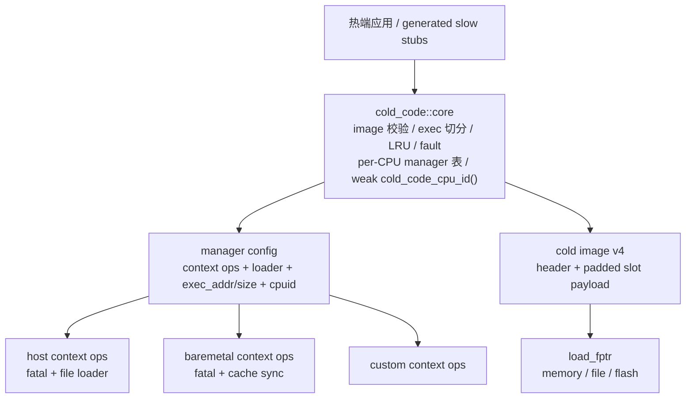
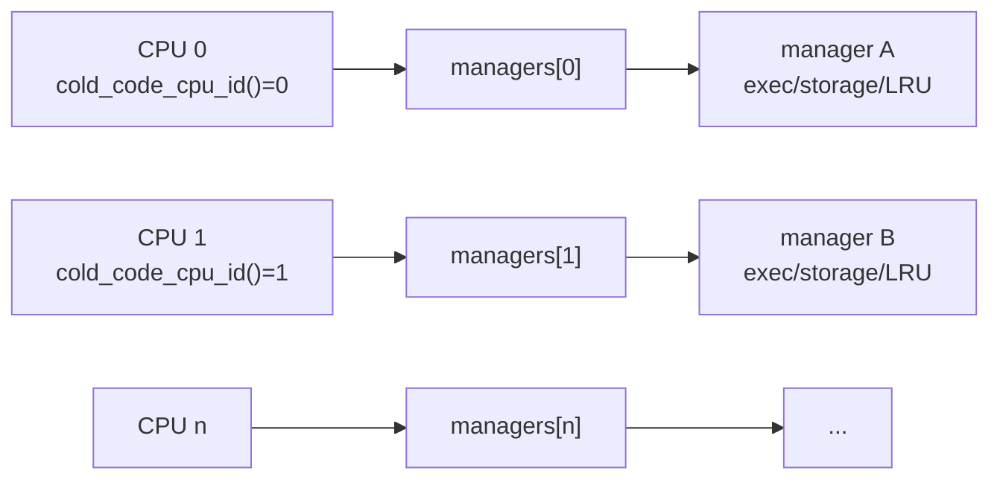
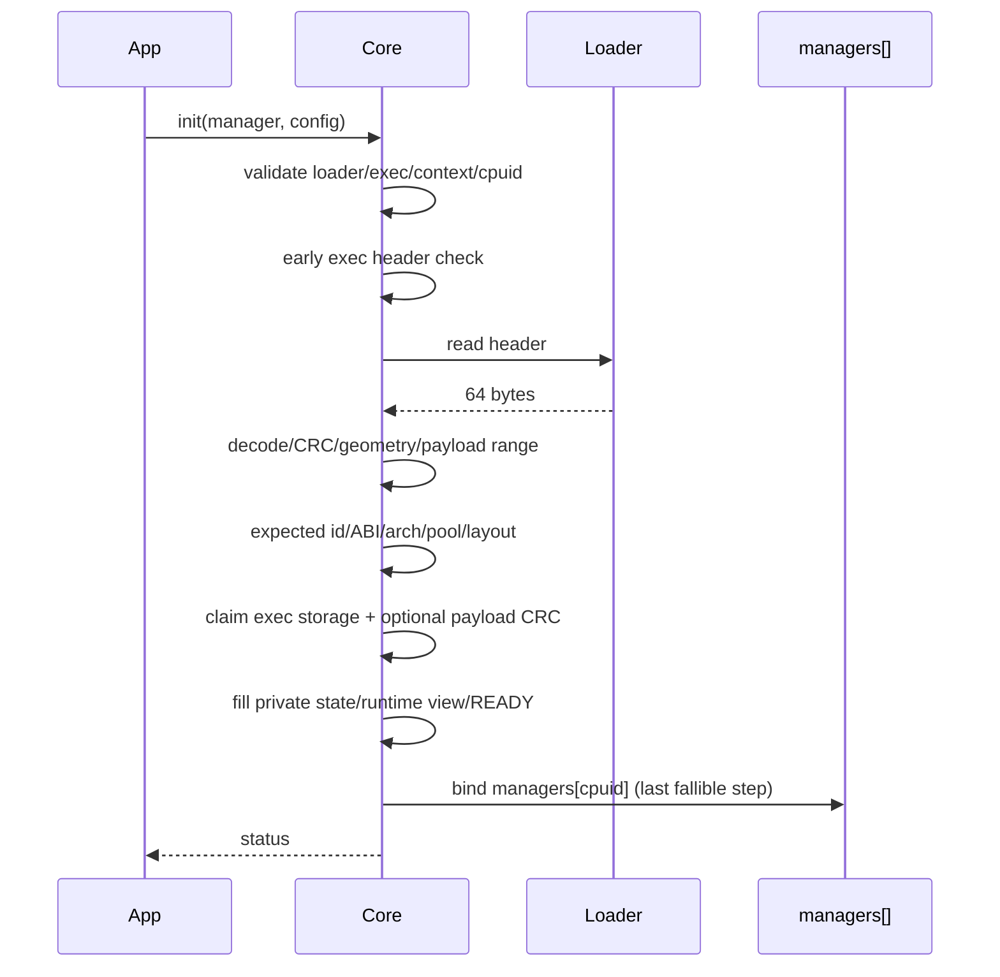
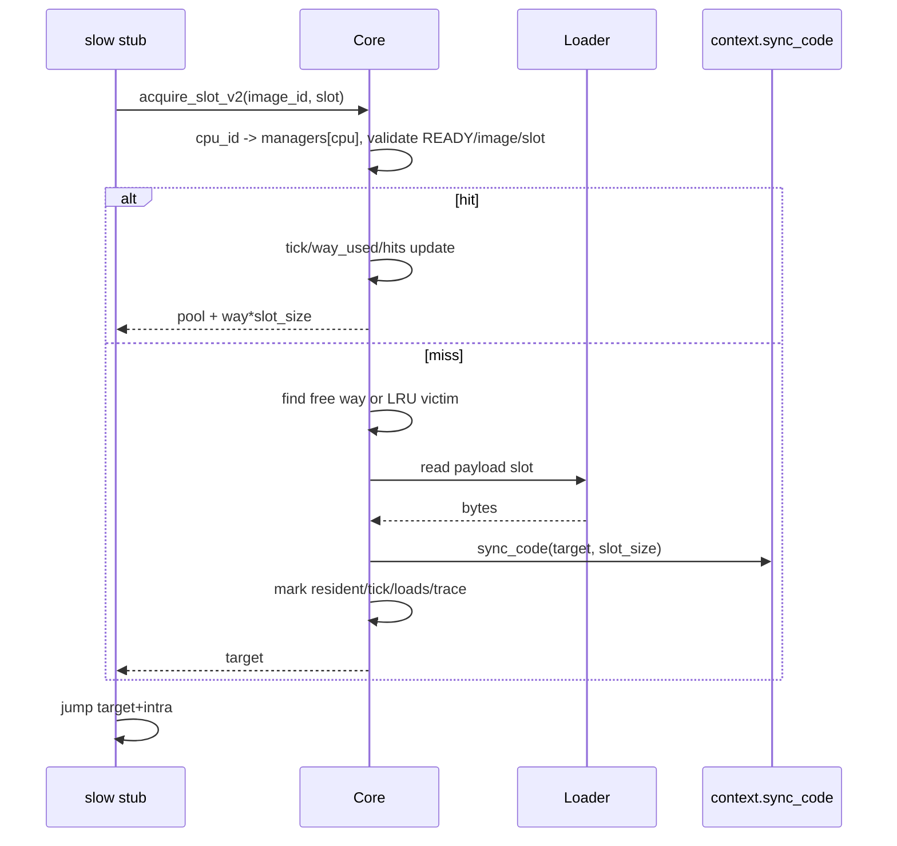

# cold_code v5 技术报告

> 本文是架构、原理、设计权衡、测试/性能证据和路线图的权威来源。快速开始与 API
> 速查见 [README](../README.md)，实现/移植/迁移细节见
> [internals](internals.md)、[porting](porting.md)、
> [migration-v4-v5](migration-v4-v5.md)。

## 1. 摘要

cold_code 是一个面向嵌入式/受限环境的 C17 冷代码按需加载库。冷函数不进入热端
镜像，而是编译进独立 flat image（模拟 flash/ROM）；热端只有生成的同名 x86-64
slow stub。首次调用把函数所在固定 slot 读入静态可执行 RAM，随后按 slot 级 LRU
换入换出。

v5 的核心变化是把平台接口、loader 和可执行内存全部通过 manager config 注入，
由 core 维护 per-CPU manager 表，并彻底删除多线程/TLS 和 FAST 路径。它保留了
image v4/ABI 2、slot 布局、slow 符号和普通函数调用语义，但公共 API、context ops
和测试模型都是 breaking 的。

## 2. 目标与非目标

**目标**

- 普通 C 函数调用；冷函数按 slot 加载、可换出。
- 不依赖 OS 动态加载（无 `dlopen`、按需分页、`SIGSEGV`、`userfaultfd`）。
- 平台无关 core；host/baremetal/custom port 可复用、可同时链接。
- 多 CPU：每个 CPU 一个 manager；不同 CPU 可并发。
- 构建期验证：slot、跨 slot 调用、未定义符号、重定位、image header/CRC。
- 可预算：固定 slot、固定 exec storage、显式 loader 和 context。

**非目标（v5）**

- 多线程/TLS/task-local；host port 单线程。
- 共享 manager 的并发、pin/refcount。
- FAST stub/accessor；所有调用走 slow path。
- 跨 slot 直接调用、冷函数引用外部数据。
- 可信执行环境；CRC 不是签名/认证。

## 3. 架构



分层：

- `cold_code::core`：freestanding loader，不依赖 libc/具体 port。
- context ops：arch/fatal/sync_code，由 config 传入。
- loader：`load_fptr + load_ctx + image_size`，负责随机读 image。
- exec：调用方提供的可执行 RAM；core 校验并切分。
- ports：host file loader、baremetal fatal/cache hooks、custom ops。

## 4. 配置、loader、exec、context

```c
typedef struct {
    cold_code_loader_t loader;
    void *exec_addr;
    size_t exec_size;
    uint32_t cpuid;
    const cold_code_context_ops_t *context;
    uint32_t pool_slots;
    uint32_t expected_image_id;
    uint32_t flags;
    cold_code_trace_t trace;
    cold_code_fault_t fault;
} cold_code_manager_config_t;
```

### 4.1 Loader

`load_fptr(ctx, offset, dst, size)` 必须支持重复/随机读，越界或 short read 返回
false。`image_size` 在一次 manager 生命周期内稳定。manager 不 close loader；
`load_ctx` 必须比 manager 活得久。多个 CPU 共享 loader 时，`load_fptr` 必须可重入，
或每个 manager 使用独立 loader。

probe 只读 64 字节 header；init 重新读 header，并在 `VERIFY_CRC` 时按 512 字节块
读取 payload。没有 open/close 会话，因此 probe 和 init 不依赖可重复 open 的 source。

### 4.2 Exec 内存

`exec_addr/exec_size` 替代 v4 的 storage 字段。core 按 image header 的
`storage_align` 和 `cold_code_storage_required_size()` 校验大小/对齐，切分
storage header、slot_map、way_slot、way_used、pool。storage header 的 owner
保证一个 exec buffer 同一时刻只属于一个 manager。

### 4.3 Context ops

```c
typedef struct cold_code_context_ops {
    uint32_t abi_version; /* 2 */
    uint32_t struct_size;
    uint32_t arch;
    void (*fatal)(const char *message);
    void (*sync_code)(void *addr, size_t size);
} cold_code_context_ops_t;
```

v5 删除全局 `cold_code_context_ops` 单例和 `current/set_current`。每个 manager 保存
`config.context`，init 校验 ABI/struct_size/arch/fatal。host/baremetal/custom 可
同时链接，不再有“一 executable 一 port”的重复符号限制。`fatal/sync_code` 可能被
多个 CPU 并发调用，port 应可重入。

## 5. Per-CPU 表与并发



- core 内部 `static cold_code_manager_t *g_managers[COLD_CODE_MAX_CPUS]`。
- `cold_code_cpu_id()` 弱定义返回 0；多 CPU 应用/target 提供强定义。
- `config.cpuid` 在 init 时绑定；一个 CPU 只能有一个 manager。
- 不同 CPU 操作不同表项，无锁、无 pin；同一 CPU 的并发 init/deinit 不支持。
- 跨 CPU 发布新 manager 时，调用方需提供发布屏障。
- `cold_code_manager_current()` 返回当前 CPU 的 manager，只读。
- 无 manager 时冷调用直接 `__builtin_trap()`；有 manager 时使用其 context fatal。
- host port 单线程；多 CPU host 测试通过强 `cold_code_cpu_id()` 顺序切换。
- baremetal 多核可并发；target 必须保证 CPU id 稳定且 `< COLD_CODE_MAX_CPUS`。

## 6. 生命周期

### 6.1 Probe

```c
cold_code_status_t cold_code_manager_probe(const cold_code_loader_t *loader,
                                           cold_code_image_info_t *out);
```

probe 检查 loader/load_fptr/image_size，读 header，decode/CRC，校验 geometry 和
payload 范围，返回 `cold_code_image_info_t`。它不检查本地 context arch/ABI，不验
payload CRC，不占 exec storage。

### 6.2 Init



失败路径：release exec storage、清零 manager；不 close loader；不解除其他 CPU 的
绑定。cpuid 越界返回 `ERR_ARG`；该 cpuid 已占用返回 `ERR_STATE`。

| 失败点 | 占 exec | loader 读 | 回滚 | 状态 |
|---|---|---|---|---|
| 参数/context/loader/exec/cpuid | 否 | 否 | 清零 manager | `ERR_ARG`/`UNSUPPORTED` |
| exec header magic/ABI/owner/对齐 | 否 | 否 | 清零 manager | `ERR_SIZE`/`ERR_STATE` |
| header read/decode/CRC/geometry | 否 | 是 | 清零 manager | `ERR_SOURCE`/`ERR_IMAGE` |
| expected id / image ABI / arch | 否 | 是 | 清零 manager | `ERR_IMAGE`/`UNSUPPORTED`/`ERR_ARCH` |
| layout/exec size/alignment | 否 | 是 | 清零 manager | `ERR_SIZE`/`ERR_ARG` |
| payload CRC | 是 | 是 | release exec/清零 | `ERR_SOURCE`/`ERR_IMAGE` |
| cpuid 已占用 | 是 | 是 | release exec/清零 | `ERR_STATE` |

### 6.3 Deinit

deinit 只清除自己的 `g_managers[cpuid]`，然后 release exec storage、清零 manager。
可在任意 CPU 上调用；不 close loader。loader/exec buffer/context 的生命周期仍归
调用方。

## 7. Slow path 与 LRU



slow stub 保存参数寄存器，调用 `cold_code_core_acquire_slot_v2`，恢复后跳到目标。
所有调用统一 slow；没有 fast accessor/public fast-state ABI。命中也要经过 C loader
和 LRU 更新，这是 v5 用简单性/并发正确性换取的代价。

## 8. Image v4 与 fingerprint

image v4 64 字节小端 header：

| offset | field |
|---|---|
| 0 | magic `COLD` |
| 4 | version 4 |
| 6 | header_size 64 |
| 8 | image_id |
| 12 | arch |
| 16 | abi_version 2 |
| 20 | slot_size |
| 24 | slot_count |
| 28 | max_pool_slots |
| 32 | payload_offset 64 |
| 36 | payload_size |
| 40 | payload_crc32 |
| 44 | flags |
| 48 | header_crc32 |
| 52 | storage_align |
| 56/60 | reserved = 0 |

`image_id` 是 build fingerprint：

```text
crc32("cold_code_image_v4\0" || name || arch || slot_size || slot_count
      || max_pool_slots || storage_align || padded_payload)
```

stub 内嵌该值；slow acquire 比较 manager 的 image_id，错配 fault `WRONG_IMAGE`。
v5 只生成 slow stub；image `.bin` 可复用，FAST stub 必须重新生成。

## 9. 测试

共 26 个 CTest：

| 类别 | 测试 |
|---|---|
| 核心/ABI | `storage_guard`、`manager_abi` |
| 基础/生命周期 | `basic`、`init`、`lru_1way`、`lru_2way`、`abi`、`preinit_abort`、`image_format` |
| 多 CPU | `multi_manager`、`same_image_two_slots`、`multi_image`、`baremetal_port`、`custom_port` |
| 多 port | `multi_port`（host + baremetal 同时链接） |
| 错配/示例 | `image_mismatch`、`example` |
| 负向构建 | `reject_cross_slot`、`reject_straddle`、`reject_self_contained`、`reject_duplicate_cold_symbol`、`reject_unsupported_arch` |
| 集成 | `auto_asm`、`arch_plugin`、`external_consumer`、`install_consumer` |

四个原 pthread 测试改为顺序 CPU 模拟；`tests/test_cpu.c` 提供强
`cold_code_cpu_id()`。测试不使用 TLS/pthread/FAST。

## 10. 性能与证据

### 10.1 环境与采样

- WSL2 x86-64，Intel i5-13600K；GCC 13.3.0，CMake 3.28.3。
- Debug 库；benchmark TU `-O2`。
- `bench_slow` 只测 slow stub：hit 反复调用 slot 0 的 `cold_lru_add`；
  miss 交替调用 slot 0 的 add 与 slot 2 的 div。
- 3 次运行取中位数。

### 10.2 结果

| 路径 | 中位数 | 采样范围 |
|---|---|---|
| slow hit | 8.33 ns/call | 8.20–9.46 |
| slow miss | 919.05 ns/call | 866.97–971.93 |

miss 远高于 hit，主要由 file loader read、LRU 扫描和 page/cache 行为决定；本机
WSL2/FS 波动明显，不能跨机器直接比较。v5 没有 FAST，因此不报告 fast hit 数字。

### 10.3 证据块

```text
commit:      worktree (v5 redesign)
date:        2026-11-03
CPU:         Intel i5-13600K
OS:          WSL2 x86-64
compiler:    GCC 13.3.0
cmake:       3.28.3
build:       Debug library (benchmark TU -O2)
command:     ./build/tests/bench_slow
samples:     3
median:      slow hit 8.33 ns, slow miss 919.05 ns
notes:       单机、无 CPU 隔离；file loader/miss 受 WSL2/FS 影响；仅作量级参考
```

## 11. 设计原则与权衡

### 11.1 config 注入平台接口

全局 context port 单例会让 host/baremetal 无法共存，也把 manager 隐式绑定到
链接期选择。v5 让 config 携带 context ops/loader/exec/cpuid，manager 保存并校验。
收益是多 port 共存、测试可注入、manager 生命周期自包含；代价是配置字段更多、
调用方必须保证指针/内存生命周期。

### 11.2 core 拥有 per-CPU 表

把 current manager 从 port TLS 移到 core 表，删除线程语义，并让 `cold_code_cpu_id()`
成为唯一的 CPU 身份来源。收益是无 TLS、host/baremetal 一致、多 CPU 可并发；
代价是同一 CPU 只能一个 manager，同一 CPU 的并发 init/deinit 不支持，跨 CPU 发布
需要同步。

### 11.3 统一 slow

FAST stub 需要固定 fast-state ABI、arch accessor 和每 CPU current 状态；在
“多 port + 多 CPU + 无线程”模型下会显著增加复杂度和并发风险。v5 删除 FAST，
所有调用走 C loader。收益是 ABI/并发模型简单；代价是 hit 路径有额外 C 调用和
LRU 更新开销。

### 11.4 不共享 manager

一个 manager 绑定一个 CPU，exec/LRU/stats 不跨 CPU 共享，因此不需要锁/pin。
不同 CPU 的冷调用可并发；同一 manager 的并发使用仍是 UB。嵌入式多 task 需要
应用调度或未来 task-local 设计，v5 不提供。

### 11.5 loader 可重入

loader 可被多个 manager/CPU 共享。把可重入责任交给调用方，core 保持无锁；
host file loader 使用只读内存，天然可重入；自定义 loader 必须满足契约。

## 12. 限制与路线图

**已知限制**

- 只实现 x86-64 slow stub；ARM/RISC-V 仅 arch 插件接口。
- 无 FAST；命中路径也走 C loader。
- 无多线程/TLS/task-local；host port 单线程。
- 无 pin；同一 manager 不跨 CPU；同一 CPU 并发 init/deinit 不支持。
- baremetal 多核并发依赖正确 CPU id 和跨 CPU 发布同步。
- 静态 RWX 段依赖内核/安全策略；嵌入式需替换 linker/port 并做 cache 维护。
- 冷函数必须自包含、单 slot、禁止跨 slot 直调。
- slot 分配依赖链接顺序；生成器解析 binutils 文本输出。
- image CRC 不是认证；不可信 image 等于任意代码执行。

**路线图**

| 阶段 | 状态 | 目标 |
|---|---|---|
| v5 稳定化 | 计划中 | 冻结 loader/context/config API；CI + benchmark 基线 |
| 可移植性 | 计划中 | ARMv7-M/AArch64/RISC-V slow backend、QEMU smoke |
| 内存保护/安全 | 探索中 | W^X/MPU、可选 pin/refcount、image 签名/认证 |
| 工具链 | 探索中 | 机器可读 ELF、确定性 slot 分配、语言绑定 |
| FAST 重新引入 | 探索中 | per-CPU fast accessor/寄存器和并发约束设计 |
| 多线程/task-local | 不在范围（v5） | 不承诺；需要独立设计和安全模型 |

路线图不是交付承诺。

## 13. 结论

cold_code v5 用 config 注入平台接口/loader/exec、core per-CPU 表和弱 CPU hook，
在“普通函数调用”语义下实现了不依赖 OS 动态加载的冷代码按需加载。它保留了
image v4/slot/LRU 的确定性，换来了 API 破坏、无 FAST 命中优化、同一 CPU 单
manager 和严格冷函数约束。适合 flash/ROM 受限、冷函数可自包含、每 CPU 独立
manager 的 host/嵌入式原型或产品。

## 14. 附录

### A. 常用命令

```bash
cmake -S . -B build -DCMAKE_BUILD_TYPE=Debug
cmake --build build -j
ctest --test-dir build --output-on-failure
./build/example/example
./build/tests/bench_slow

cmake --install build --prefix /tmp/cold-code
cmake -S tests/fixtures/install_consumer -B /tmp/cc-consumer \
      -DCMAKE_PREFIX_PATH=/tmp/cold-code
cmake --build /tmp/cc-consumer -j && /tmp/cc-consumer/consumer
```

### B. 关键文件

| 文件 | 用途 |
|---|---|
| `cold_code/include/cold_code.h` | 公共 API umbrella |
| `cold_code/include/cold_code/loader.h` | load_fptr/memory loader |
| `cold_code/include/cold_code/port.h` | context ops v2 |
| `cold_code/include/cold_code/context.h` | per-CPU current/cpu_id hook |
| `cold_code/include/cold_code/manager.h` | opaque manager/config/生命周期 |
| `cold_code/include/cold_code/storage.h` | exec 尺寸/布局/宏 |
| `cold_code/include/cold_code/image.h` | runtime view/info/wire header/CRC |
| `cold_code/src/core/manager.c` | per-CPU 表/生命周期/LRU/acquire |
| `cold_code/src/core/loader.c` | memory loader |
| `cold_code/src/core/image.c` | image v4 编解码/CRC/probe metadata |
| `cold_code/src/core/storage.c` | exec 切分/校验 |
| `cold_code/src/core/fault.c` | context 校验/fatal/trap |
| `cold_code/src/port/host/` | host context + file loader |
| `cold_code/src/port/baremetal/` | baremetal fatal/sync ops |
| `cold_code/tool/gen_cold_code.py` | slow stub 生成器 |
| `cold_code/tool/arch/x86_64.py` | x86-64 slow backend |
| `cold_code/cmake/ColdCodeImage.cmake` | CMake helper |
| `tests/test_multi_port_v3.c` | host+baremetal 多 port 测试 |

### C. 术语表

| 术语 | 说明 |
|---|---|
| cold image | 独立 flat image，含 v4 header + padded slot payload |
| slot | 固定大小加载单元 |
| way | pool 中的物理槽位 |
| image_id | build fingerprint（name + geometry + padded payload） |
| runtime view | manager 自有的 `cold_code_image_t` 元数据视图（`name == NULL`） |
| manager | 一个 CPU 的加载器实例 |
| context ops | arch/fatal/sync_code 平台接口，由 config 传入 |
| loader | `load_fptr + load_ctx + image_size` |
| exec | 调用方提供的可执行 RAM |
| cpu_id hook | 强/弱 `cold_code_cpu_id()`，索引 per-CPU manager 表 |
| dirty/evict | 池满时移除最久未使用 slot |
